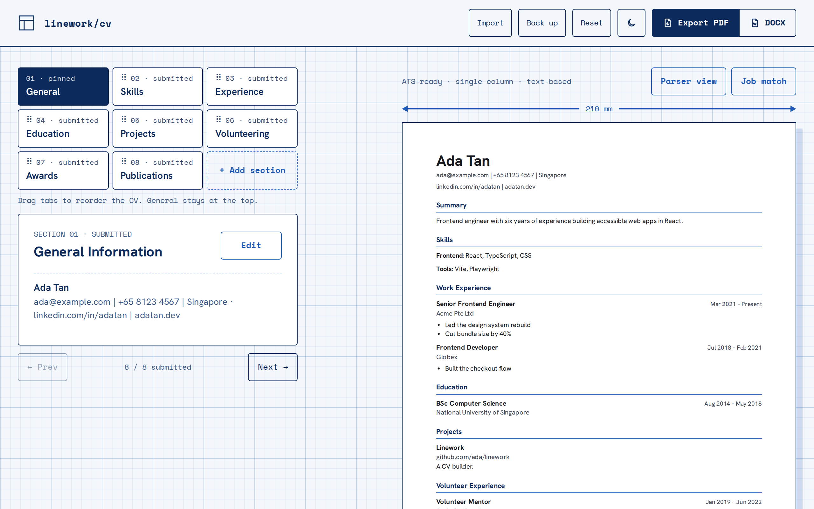

# Linework

**Live site: [linework-delta.vercel.app](https://linework-delta.vercel.app/)**

Linework is a CV builder that runs entirely in your browser. You fill in each section, see your CV update on a live A4 page beside the editor, and export it as a PDF or Word file that applicant tracking systems (ATS) can read. There's no sign-up and no server: your CV is saved in your own browser.



## Features

- **ATS-friendly output:** a single-column layout with standard headings and real text (not an image), as a PDF or DOCX.
- **Live A4 preview** with page breaks that never split an entry, plus a **parser view** showing the plain text an ATS would extract.
- **Job match:** paste a job ad to see which of its key terms your CV already uses and which are missing.
- **Writing hints** on bullet points: weak openings, missing numbers, overly long lines, repeated verbs.
- **Sections:** General, Skills, Work Experience and Education, plus optional Projects, Certifications, Languages, Volunteer Experience, Awards and Publications. Reorder sections by dragging, and reorder the entries within them.
- **Import** an existing CV from PDF or Word, **back up** to a file and restore it, and **undo** removals and resets.
- Light and dark themes on a drafting-paper grid, a mobile layout, keyboard and screen reader support.

## Development

Built with Vite and React (plain JavaScript and CSS), `docx` for Word export and `@dnd-kit` for drag and drop.

```bash
npm install
npm run dev        # start the dev server
npm run build      # production build in dist/
npm run lint
npm test           # unit tests (Vitest)
npm run test:e2e   # browser tests (Playwright; first run: npx playwright install chromium)
```

CI runs lint, the unit tests, the build and the browser tests on every push. The site deploys to Vercel from `main`.
